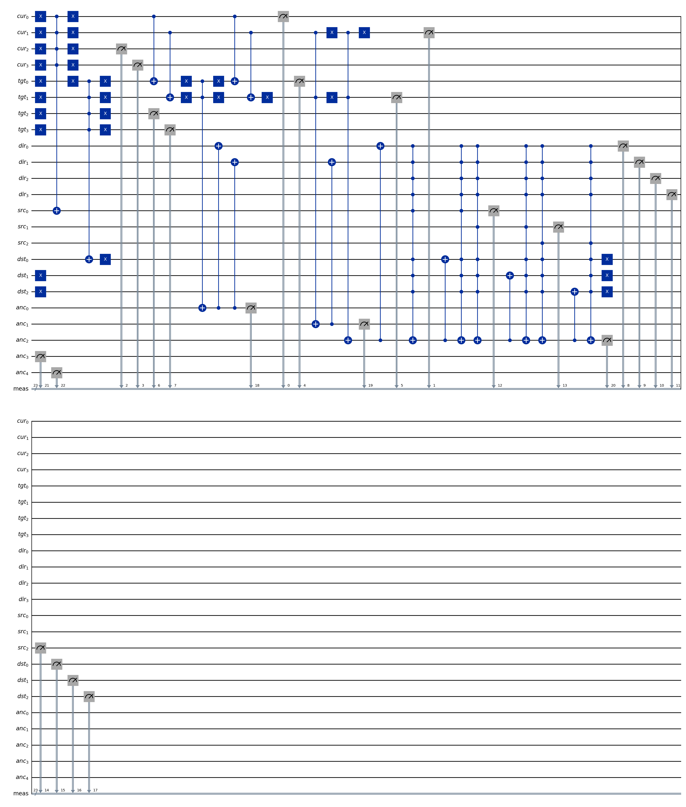

# Explaining the 2×2 Quantum Chess Circuit and Grover Search

A faculty walkthrough of the circuit in [`architecture_2x2.png`](docs/assets/diagrams/architecture_2x2.png), followed by the separate Grover move-index search. The gate behavior below follows the current source code and the example used to generate this diagram.

## First, the story in one minute

The 2×2 board contains one Black Pawn at `(row 0, column 0)`. Classical Python finds its only legal move, `(0,0) -> (1,0)`. The 23-qubit circuit then encodes that known source and target, looks up their piece-status values, attempts to detect the move direction, and measures the registers.

For this input, the source lookup works and the destination lookup correctly stays empty. The current direction circuit does **not** recognize this forward move: its equality test uses the row-bit slices, and the source and destination rows differ. The direction register therefore remains zero. The final controlled status gates do not fire, so the circuit is a diagnostic prototype and does not update a chessboard.

Grover's algorithm is a different circuit. In the hybrid search, classical code generates legal moves and scores them; Grover acts on their integer list indices. Its oracle phase-marks selected indices and its diffuser makes those phase differences interfere, which can raise the marked-index measurement probability for a suitable search size and iteration count.

<!-- pagebreak -->
## Circuit overview: architecture_2x2.png



*The circuit image is embedded at full source resolution. Zoom in to point to a wire or gate. Gate-sequence numbers in the walkthrough are zero-based operation positions from the builder; they are not printed in the image.*

<!-- pagebreak -->
## 1. Read the circuit picture

The figure is a Qiskit circuit drawing. Read each horizontal wire from left to right: its state is carried forward and later gates act on that updated state. A gate does not pass a classical value down a pipe; the qubits jointly hold the circuit state. Qiskit may place gates on independent wires in the same visual column, so use both the wire labels and the ordered gate groups below.

| Symbol in the figure | How to read it |
|---|---|
| Blue `X` square | Apply NOT to that wire: `0 ↔ 1`. |
| Filled control dot joined to a target with `⊕` | A controlled-X. The target flips only when the control is 1. Several dots joined to one target make a multi-controlled X; every control must be 1. |
| Gray meter symbol and vertical line to `meas` | Measure that qubit and write the result to a classical bit. Measurement is at the end of the computation. |
| `cur`, `tgt`, `dir`, `src`, `dst`, `anc` wire names | Current/source coordinate, target coordinate, direction result, source/destination status, and scratch workspace. |
| Small numbers on the `meas` line | Classical-bit destinations, not gate numbers, board coordinates, or move indices. |

The diagram is folded to fit on a page. Gray measurement symbols can appear at different horizontal positions because Qiskit places a measurement after that wire’s last gate use; other wires may continue through later gates. They are still final readouts, not intermediate chess decisions. Read each quantum wire in sequence. The final measurement result is described after the gate trace.

## 2. Inputs and the register map

Coordinates are `(row, column)`, with rows increasing downward. The board at circuit-build time is:

| Square | Contents |
|---|---|
| `(0,0)` | Black Pawn |
| `(0,1)`, `(1,0)`, `(1,1)` | Empty |

The move was already selected classically: source `(0,0)` to target `(1,0)`. `BoardEncoder` writes column bits followed by row bits. With two bits per axis, the logical values are `(0,0) = 0000` and `(1,0) = 0001`. Qiskit qubit index 0 is the rightmost bit, so the target is loaded with `X(tgt[0])`.

| Register | Qubits | Starting / intended value | Role |
|---|---:|---|---|
| `cur[0..3]` | 4 | `0000` | Source coordinate |
| `tgt[0..3]` | 4 | `0001` | Target coordinate |
| `dir[0..3]` | 4 | `0000` | Move-direction workspace |
| `src[0..2]` | 3 | `000` initially; lookup should make `001` | Source-square status |
| `dst[0..2]` | 3 | `000` | Destination-square status |
| `anc[0..4]` | 5 | `00000` | Temporary comparison / operation bits |

A Black Pawn is encoded as `001`; an empty square is `000`. The logical status string is printed most-significant bit first, so `src=001` means `src[0]=1`, with `src[1]=src[2]=0`. The encoding is a compact prototype, not a complete chess-board data structure.

The 23 qubits are allocated as `4 + 4 + 4 + 3 + 3 + 5`. There is no register containing all four squares as a board that can be rewritten. The circuit receives the classical board and the chosen move as input data.

## 3. Follow the gates and their outputs

The operation numbers below identify the gate sequence produced by `PureQuantumCircuitBuilder`. For every controlled gate, the output keeps the control bits and flips only the target when all required controls are 1.

### A. Load the target coordinate - operation 0

`X(tgt[0])` changes `tgt[0]: 0 -> 1`. All other coordinate bits stay zero. The register now represents `cur=0000`, `tgt=0001`, which is the supplied move. There is no H gate here, so this is a definite basis-state input, not a superposition of moves.

### B. Look up the source square - operations 1 to 9

The source status extractor uses the classical board as a reversible lookup table. It processes the only occupied square, `(0,0)`, whose address is `0000` and status is `001`.

| Operation(s) | Gate and wires | Input -> output | Why / what feeds forward |
|---|---|---|---|
| 1-4 | `X` on `cur[0]` through `cur[3]` | `cur: 0000 -> 1111` temporarily | MCX controls activate on 1. The X gates turn the all-zero address into the all-one match pattern. |
| 5 | 4-control MCX: `cur[0..3]` controls, `src[0]` target | Controls are `1111`; `src[0]: 0 -> 1` | The address matches. The pawn status has its least-significant bit set, so that status bit is written to `src[0]`. |
| 6-9 | Undo the four `cur` X gates | `cur: 1111 -> 0000`; `src` stays `001` | Uncomputes the temporary address pattern. The source coordinate is available unchanged for the next phase. |

The result is `src=001`: the circuit has copied the pawn's status into a register. The `src[0]` value is the output that later status logic can use as a control.

### C. Look up the target square - operations 10 to 18

The same occupied-square lookup is attempted on `tgt`. Operations 10-13 temporarily apply X to all four target bits. Since `tgt` starts as `0001`, it becomes `1110` in the qubit-control pattern. Operation 14 is a four-control MCX from `tgt[0..3]` to `dst[0]`. One control is 0, so it does not fire. Operations 15-18 undo the X gates and restore `tgt=0001`.

Output: `dst` remains `000`, correctly representing an empty target at the time this circuit was built. The coordinate register is restored and feeds into the next computation.

### D. Compare coordinates and attempt direction detection - operations 19 to 37

This is the key limitation to explain while pointing at the direction wires. The coordinate string is column bits followed by row bits, but Qiskit stores the rightmost bits at the low qubit indices. Consequently, `cur[0:2]` and `tgt[0:2]` are the **row** bits in this encoding, even though the code names these slices `cur_x` and `tgt_x`.

For this move the row values differ: source row 0 is `00`, target row 1 is `01`. In qubit-index order, `cur[0:2]=[0,0]`, `tgt[0:2]=[1,0]`.

| Operation(s) | Gate action and intermediate result | Output passed on |
|---|---|---|
| 19-22 | `CX(cur[0],tgt[0])`, `X(tgt[0])`, then the same pattern for bit 1. With controls 0, the temporary target comparison bits become `[0,1]`. | The two comparison controls do not both equal 1. |
| 23 | CCX on the two temporary target bits, target `anc[0]` | Since the controls are `[0,1]`, it does not flip. `anc[0]` stays 0: the implemented equality test failed. |
| 24-27 | Reverse the temporary compare with X/CX gates | `tgt` is restored to `0001`; the failed result remains `anc[0]=0`. |
| 28-29 | CX from `anc[0]` to `dir[0]` and `dir[1]` | Control is 0, so neither direction bit changes. |
| 30-33 | X/CCX/X checks a limited diagonal-left pattern and copies `anc[1]` to `dir[1]` | The CCX controls are not both 1. `anc[1]` and `dir[1]` stay 0. |
| 34-37 | X/CCX/X checks a limited diagonal-right pattern and copies `anc[2]` to `dir[0]` | The CCX controls are not both 1. `anc[2]` and `dir[0]` stay 0. |

Output: `dir=0000`, and `anc[0..2]=000`. The code is meant to set direction bits from comparison results, but this comparison does not implement a full row increment / column equality predicate. It misses the example's forward move. This is not a Grover failure; this is a limitation in the separate coordinate/status circuit.

### E. Try the status transformation - operations 38 to 52

The method called `_add_status_operator` attempts a conditional status change. It is not a full board update.

1. Operations 38-40 apply X to `dst[0..2]`, changing `dst=000` to temporary `111`. This makes an originally empty destination recognizable to positive controls.
2. Operations 41, 43, 44, 46, 47, and 49 are multi-controlled X gates. Each requires **all four `dir` bits**, all three complemented `dst` bits, and one `src` bit to equal 1; the target is scratch qubit `anc[2]`.
3. Because `dir=0000`, the direction controls are false. None of these MCX gates fires, even though `src[0]=1` and temporary `dst=111` for the first status bit. The intervening CX gates (42, 45, 48) use `anc[2]=0`, so they do not change `dst`.
4. Operations 50-52 undo the temporary destination X gates: `dst=111 -> 000`.

Output: `src=001`, `dst=000`, `dir=0000`, and the ancillas return to zero for this input. No piece is transferred. The source status is not cleared, there is no mutable board register, and no chess move is applied by this circuit.

### F. Gate legend: input, action, output

| Gate | What goes in | What it does | What comes out / why it is used |
|---|---|---|---|
| X | One qubit, for example `tgt[0]=0` | Flips 0 to 1 or 1 to 0 | Here it loads target row bit 1 or temporarily flips zero-valued controls so MCX can test an address. Paired X gates restore temporary changes. |
| CX | Control and target, for example `cur[0]=0`, `tgt[0]=1` | Target becomes `target XOR control` | A zero control leaves target 1; a one control flips it. Here CX participates in the temporary bit comparison and later copies a computed flag. |
| CCX | Two controls and one target | Flips the target only if both controls are 1 | Here it combines comparison bits into an ancilla flag. In this example the tested patterns fail, so the ancillas remain 0. |
| MCX | Several controls and one target | Flips the target only if every control is 1 | It writes the source status when the coordinate matches, checks the target address, and attempts the conditional status transformation. |
| Measurement | A qubit and a classical output bit | Samples the quantum register in the computational basis | It produces classical bits for printing. It does not update the board. |

All gates in this 23-qubit circuit are X, CX, CCX, or MCX; there is no Hadamard gate. The input is a basis state and these gates map basis states to basis states. The ideal direct statevector simulation therefore gives a definite basis result; this measurement is not evidence of amplitude amplification.

## 4. Read the final measurement

The builder measures all 23 qubits. Qiskit displays the highest-index classical bit on the left, so the printed string reads in reverse register order. The expected one-shot key for this input is:

```text
00000 000 001 0000 0001 0000
 anc   dst src  dir  tgt  cur
```

Without spaces: `00000000001000000010000`. These groups report scratch bits, destination status, source status, direction, target coordinate, and source coordinate. This is a measured circuit record, not a four-square board encoding. Option 7 reports it and saves the diagram; it does not call `Game.make_move` to update a persistent board.

## 5. The separate Grover circuit: from a move list to an index

Grover's search in this repository is a hybrid pipeline. It searches numbers that refer to list positions; it does not encode an entire chess position.

### Phase 1 - Python prepares candidates and targets

In `QuantumMoveSearcher`, `MoveGenerator.generate_legal_moves(state)` creates the legal `Move` objects as an ordered Python list. `HeuristicEvaluator.score_move` scores each move classically. The code finds the maximum score and passes the list positions with that score as `optimal_indices` to `GroverSearch`.

A representative 3×3 list is:

| Index | Legal move | Classical score |
|---:|---|---:|
| 0 | Knight `(2,1) -> (0,0)`, capturing a Black Pawn | 13.3 |
| 1 | Knight `(2,1) -> (0,2)` | 4.4 |

Here Python passes target list `[0]`. The score is not computed by the quantum circuit. If there are `L` candidates, the index register uses `n=ceil(log₂ L)` qubits (at least one) and represents `N=2ⁿ` bit patterns. If `L` is not a power of two, the extra patterns are padding and have no move.

Important route detail: `GroverSearch.search(state)` by itself gets legal candidates and, by default, marks every one of them legal. If every candidate is a target, it returns early and builds no Grover circuit. The hybrid scorer passes a strict subset of best-scoring indices when there is a distinct best move, which is the case that can exercise the Grover circuit. Option 7's one-move 2×2 run returns early for this reason.

### Phase 2 - H gates create candidate superposition; X and H prepare the flag

For two candidate moves, one move-index qubit starts in `|0⟩`. The Hadamard gate makes:

```text
H|0⟩ = (|0⟩ + |1⟩) / √2
```

Now both list positions are represented in the index register. The flag qubit starts at `|0⟩`; X then H gives:

```text
|0⟩ --X--> |1⟩ --H--> |−⟩ = (|0⟩ - |1⟩) / √2
```

The flag is prepared this way so a controlled-X flips its phase while returning the flag to `|−⟩`.

### Phase 3 - The oracle marks a target index by phase kickback

For target index 0, the index bit is zero. The oracle applies X to that index qubit temporarily, so its controls become all 1; an MCX controlled by the index register targets the flag; then X restores the index. Since `X|−⟩=-|−⟩`, the flag flip changes the amplitude sign associated with the matched move index. The index register itself is restored:

```text
unmarked index: amplitude +a       marked index: amplitude -a
```

Python supplies the target index. The oracle does not run the move rules or score the board in superposition. The phase flip alone does not change measurement probabilities because `|a|²=|-a|²`.

### Phase 4 - The diffuser converts the phase mark into probability change

The diffuser acts on the move-index register, not on the 23-qubit coordinate/status registers. Its circuit sequence is:

```text
H on index qubits
X on index qubits
central multi-controlled Z
X on index qubits
H on index qubits
```

For one index qubit, the central gate is Z. For more than one, Qiskit builds a multi-controlled Z using H on the last qubit, MCX, then H on the last qubit. The full operation reflects amplitudes about their average:

```text
aᵢ' = 2ā - aᵢ
```

where `ā` is the mean amplitude. The oracle first makes target amplitudes negative; the reflection can then raise them and reduce unmarked amplitudes. Repeating oracle + diffuser rotates probability toward the marked set. Too many rounds can rotate past the best point, so the iteration count matters. The diffuser is needed because the oracle's sign change by itself leaves probabilities unchanged.

### A four-index example where amplification is clear

With four candidate indices and one target `00`, two H gates prepare equal amplitudes of `1/2` and probabilities of `1/4`:

```text
Before oracle: (+|00⟩ + |01⟩ + |10⟩ + |11⟩) / 2
After oracle:  (-|00⟩ + |01⟩ + |10⟩ + |11⟩) / 2
```

The mean amplitude after the oracle is `ā=1/4`. The diffuser gives target amplitude `2(1/4)-(-1/2)=1`; each unmarked amplitude becomes `2(1/4)-(1/2)=0`. Thus the ideal one-iteration example measures `00` with probability 1. Here `N=4`, `M=1`, and `floor((π/4)√(N/M))=1` iteration.

The code's documented two-candidate example is different: with `N=2`, `M=1`, the target begins at probability `1/2` and one Grover iteration leaves it at `1/2`. The program can still return a target because it checks the measured index and falls back to the first target. Explain the sampled probability and the classical fallback separately.

### Phase 5 - Measure and map the integer back to a move

The Grover circuit measures only the move-index register; it does not measure the flag. Classical code reads the bit string as an integer, checks that it is in range and in `optimal_indices`, and returns `candidates[index]`. If the sample is not a usable target, it returns the first target as a fallback. The console label “Prob Amplitude” is a measured frequency, not a quantum amplitude.

## 6. Terms your faculty may ask about

| Term | Meaning in this project |
|---|---|
| **Qubit / register** | Simulated two-state unit / named group of qubits, such as `tgt` or the Grover `move` index. |
| **Amplitude / probability** | Complex state coefficient / squared magnitude of that coefficient. A sign flip alone does not alter probability. |
| **Oracle / marked index** | Reversible circuit that phase-flips index values supplied by Python / one such selected list position. |
| **Diffuser / Grover iteration** | Reflection about the mean / one oracle followed by one diffuser. |
| **Shot** | One circuit execution ending in measurement. More shots estimate outcome frequencies. |
| **Noise / gate error rate** | A simulator model for imperfect gates. `QUANTUM_NOISE_PROB=0.01` is a configured single-qubit depolarizing parameter; the wrapper uses 10 times this for selected two-qubit gates. It is a setting, not a measured hardware rate. |
| **AerSimulator / statevector** | Local Qiskit software simulation / a simulation method that evolves amplitudes. The direct 2×2 route uses one shot and supplies no noise model. |
| **Shared simulator wrapper** | `QuantumSimulator` centralizes Aer execution, transpilation, shots, and optional noise. Its defaults are 1024 shots and configured noise enabled; option 7's diagnostic circuit runs Aer directly instead. |
| **Minimax** | Separate classical game-tree search: select a move assuming the opponent chooses responses that minimize the evaluation. Alpha-beta pruning skips branches that cannot affect that decision. |

## Faculty closing explanation

“The picture shows a reversible coordinate/status circuit. Blue X gates load bits or temporarily complement controls; connected control dots and X targets implement conditional flips. The source lookup writes `src=001`, the target lookup leaves `dst=000`, but the direction comparison outputs `dir=0000` for this example. Because the later status MCX gates require all direction controls to be 1, they do not fire. Measurement reports the registers; it does not execute a chess move. Separately, the hybrid Grover search takes Python's legal-move list and classically selected best indices, makes a superposition of those indices, marks targets by phase kickback, and uses the diffuser to alter their measurement probabilities. Python finally maps and validates the measured index.”
