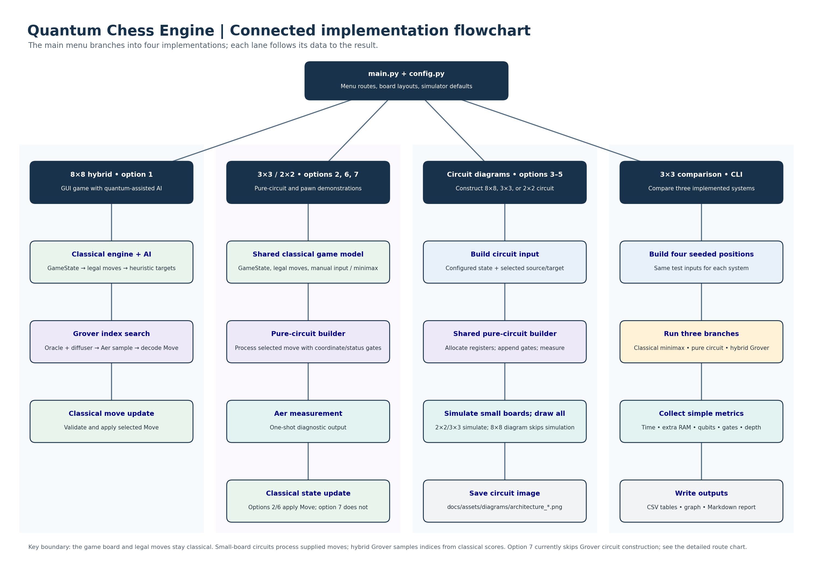
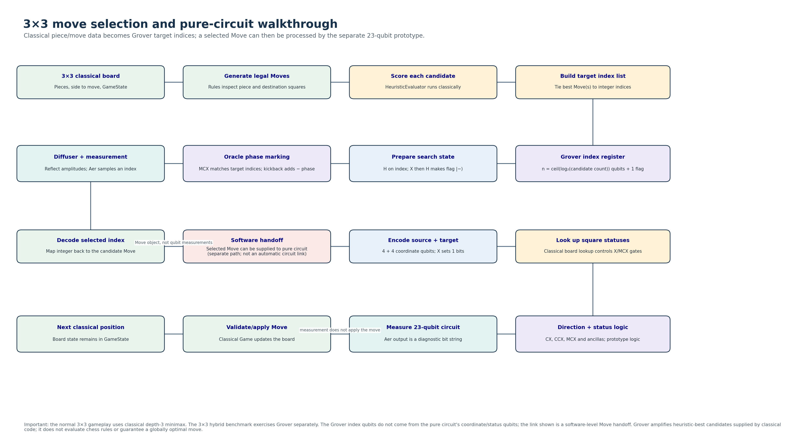
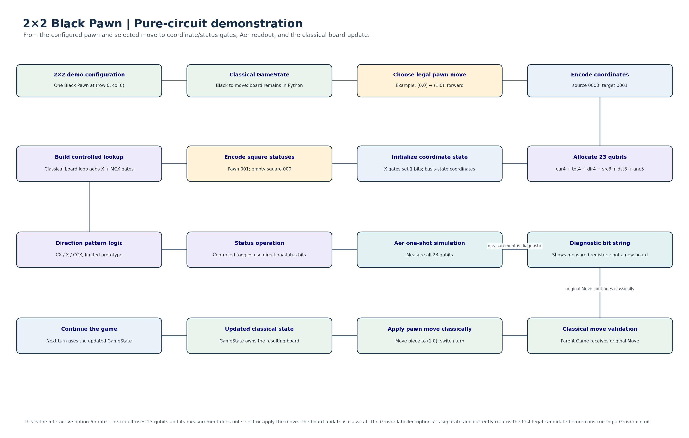
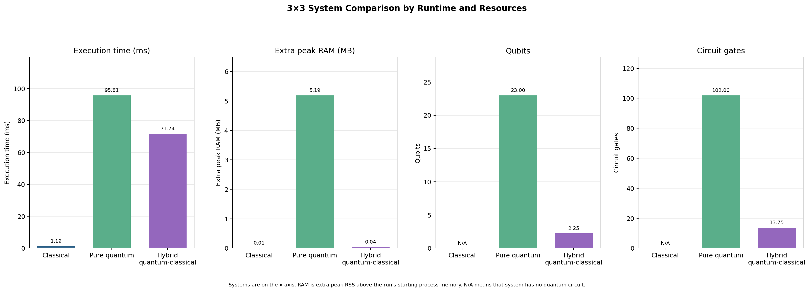

# Quantum Chess Engine

An educational project that combines a classical chess model with Qiskit circuit simulation. It includes an 8×8 hybrid move-selection demo, small-board 3×3 and 2×2 circuit demonstrations, and a simple 3×3 comparison of runtime and circuit resources.

The board, legal move generation, and final game updates are classical. The hybrid Grover path amplifies indices that classical code has already selected as heuristic-best candidates. The small-board “pure quantum” circuit processes a supplied move and reports a measurement; it does not choose or apply that move. These are distinct circuit paths.

## Contents

- [Project overview](#project-overview)
- [Implemented systems](#implemented-systems)
- [Architecture and data flow](#architecture-and-data-flow)
- [How the circuits work](#how-the-circuits-work)
- [Worked example](#worked-example-3x3-knight-capture)
- [Evaluation results](#evaluation-results)
- [Installation](#installation)
- [Run the project](#run-the-project)
- [Configuration](#configuration)
- [Repository structure](#repository-structure)
- [Reports and project documentation](#reports-and-project-documentation)
- [Limitations](#limitations)
- [License](#license)

## Project overview

The goal is to demonstrate how classical chess software can prepare data for quantum circuits and how Qiskit Aer can simulate gates, Grover amplitude amplification, and measurements. Small boards make the coordinate and status circuits easier to inspect. The 8×8 hybrid mode demonstrates a separate search over compact move-list indices.



### Implemented systems

| System | What it does | What remains classical |
|---|---|---|
| **8×8 hybrid game** | Generates legal moves, scores them, and uses a Grover index circuit to sample among the best-scoring indices. Minimax is available as a fallback. | Board state, legal move generation, heuristic scoring, move decoding, validation, and board update. |
| **3×3 pure-circuit game** | Builds and simulates a 23-qubit coordinate/status circuit for each supplied move. | Move selection and AI opponent use classical minimax; the classical game applies the move. |
| **2×2 interactive pawn demo** | Uses one Black Pawn to demonstrate coordinate encoding, controlled gates, and measurement. | The player supplies the move; the classical game applies it. |
| **2×2 Grover-labelled demo** | Runs its demo route and then the pure-circuit example. | With its current default candidate list, all candidates are marked, so the Grover helper returns the first one before building a Grover circuit. |
| **3×3 system comparison** | Measures a classical minimax selector, a pure-circuit move-processing task, and hybrid Grover simulation on the same seeded positions. | The three systems perform different tasks; their times are basic resource measurements, not a move-quality or speedup comparison. |

The normal 3×3 game does not use Grover to choose its AI move. The 3×3 benchmark’s hybrid branch does run Grover. The 2×2 interactive route does not use Grover.

## Architecture and data flow

```text
main.py and Pygame UI
    |
    +-- Classical chess model: Board, GameState, Move, Rules
    |       |
    |       +-- MoveGenerator: legal candidate list
    |       |
    |       +-- Minimax / HeuristicEvaluator: classical move choice and scores
    |                |
    |                +-- Hybrid route: best candidate indices -> Grover -> measured index
    |                                                   -> classical Move lookup and update
    |
    +-- Small-board pure circuit: supplied Move + classical board lookup
            -> coordinate/status/direction registers -> Aer measurement
            -> classical Game applies the original Move
```

The source of truth for pieces and turns is `engine.GameState`. The classical move generator prepares legal `Move` objects. In the hybrid route, `HeuristicEvaluator` computes target scores before the Grover circuit is constructed. The measured Grover index is converted back to an item in that same classical list.

The coordinate/status circuit and Grover index circuit are not wired into one quantum circuit. The chart below shows their relationship at the software boundary: a `Move` can be supplied to the pure circuit separately, but measurement bits from the pure circuit do not become Grover indices.



The focused 2×2 example follows the Black Pawn from its configured square through the circuit and back to the classical game state:



## How the circuits work

### Small-board coordinate and status circuit

For a 2×2 or 3×3 board, each coordinate axis uses two bits. The source and target coordinates therefore take four qubits each. `PureQuantumRegisters` allocates:

| Register | Qubits | Role |
|---|---:|---|
| `cur` | 4 | Source coordinate |
| `tgt` | 4 | Destination coordinate |
| `dir` | 4 | Direction workspace |
| `src` | 3 | Source-square status |
| `dst` | 3 | Destination-square status |
| `anc` | 5 | Temporary workspace |
| **Total** | **23** | Each qubit is measured to a classical readout bit |

The pure-circuit builder encodes the supplied source and target, loops over the classical board to add coordinate-controlled status lookup gates, appends limited direction and status logic, and measures the registers. It does not store every board square in qubits. The status lookup gates are generated from the Python board when the circuit is built.

The encoder stores column bits first, then row bits. For example, `(row=2, col=1)` on a 3×3 board is column `01` plus row `10`, or `0110`. A 2×2 Black Pawn at `(0,0)` is `0000`; its example destination `(1,0)` is `0001`.

Small boards use a compact three-bit status code: empty `000`, Black Pawn `001`, White Pawn `101`, Black Knight `010`, White Knight `110`. Some piece types share type codes, so this compact encoding is not unique across every chess piece.

The principal gates are:

- **X:** flips `|0⟩` and `|1⟩`. It initializes coordinate 1-bits and temporarily flips zero-valued controls during equality-pattern checks.
- **CX:** flips a target when one control is `1`.
- **CCX:** Toffoli gate; flips a target when both controls are `1`.
- **MCX:** flips a target when all controls are `1`. It is used for status lookups and controlled prototype logic.
- **Measurement:** samples the circuit's computational-basis state into classical bits. The result is diagnostic; it is not interpreted as a new complete chess board.

For boards with side length at least five, the status registers are six bits wide. The 8×8 pure-circuit diagram allocation is 33 qubits in total. This is a register allocation, not a claim that all 8×8 movement rules are implemented in that circuit.

### Grover move-index circuit

The hybrid search uses a different representation. If there are `C` legal candidate moves, the index register uses `ceil(log2(C))` qubits, with at least one, plus one flag qubit. It represents integers into a Python list, not squares or pieces.

1. Classical `MoveGenerator` produces legal moves.
2. Classical `HeuristicEvaluator` scores each move and gathers indices tied for the highest score.
3. Hadamard gates create a uniform superposition over the binary index space.
4. The flag is prepared in `|−⟩` by X then H. The oracle matches each target index with X and MCX gates. The flag flip causes phase kickback, adding a minus sign to each marked index amplitude.
5. The diffuser reflects amplitudes about their mean, increasing the probability of measuring a marked index for suitable search sizes and iteration counts.
6. Aer measures an index. Classical code looks up the corresponding `Move`, checks it, and uses a fallback if the sample is not an acceptable target.

This implementation amplifies heuristic-best indices provided by classical code. The Grover oracle does not calculate legal chess moves or heuristic scores in superposition.

## Worked example: 3×3 Knight capture

The configured 3×3 position has a White Knight at `(2,1)` and a Black Pawn at `(0,0)`, with White to move. For this example, the legal-move generator returns two candidates:

| Candidate index | Move | Heuristic score |
|---:|---|---:|
| 0 | `(2,1) → (0,0)`, capturing the Black Pawn | 13.3 |
| 1 | `(2,1) → (0,2)` | 4.4 |

The scores are calculated classically. Index 0 is the best-scoring target, so the Grover index register needs one qubit: `ceil(log2(2)) = 1`. After H, the index state is:

```text
(|0> + |1>) / sqrt(2)
```

The oracle marks index 0 by changing its phase:

```text
(-|0> + |1>) / sqrt(2)
```

For this two-item, one-target ideal example, one Grover iteration followed by measurement returns index 0 with probability 1 in an ideal noiseless simulation. The program maps index 0 back to the Knight capture `Move`. This means “best” under this one-ply heuristic ranking, not a proof of a globally optimal chess strategy.

If the same selected move is supplied separately to the pure-circuit builder, its source coordinate `(2,1)` is encoded as `0110`, and its target `(0,0)` as `0000`. The builder constructs a 23-qubit coordinate/status circuit and returns diagnostic measurement data. The classical `Game` object then applies the original `Move`. This combined walkthrough explains the reusable components; it is not an automatic quantum connection in the normal 3×3 gameplay route, where the AI uses depth-3 classical minimax.

For the 2×2 example, the configured Black Pawn at `(0,0)` moves forward to `(1,0)`. The source and target encodings are `0000` and `0001`; the compact statuses are Black Pawn `001` and empty `000`. The circuit runs after the user chooses a legal move, then the classical game applies it.

## Evaluation results

The checked-in comparison uses four seeded 3×3 positions (`seed=20261013`). The classical branch uses depth-3 minimax. The pure branch processes a supplied legal move and simulates the 23-qubit circuit for one shot per position. The hybrid branch runs the Grover move-index circuit with 2048 shots per position. Both quantum branches use the Aer CPU matrix-product-state simulator with noise disabled. Simulator setup is excluded from the measured operation time.

| System | Average execution time (ms) | Average extra peak RAM (MB) | Average legal moves | Average qubits | Average gates | Average depth |
|---|---:|---:|---:|---:|---:|---:|
| 3×3 Classical | 1.19 | 0.0068 | 2.25 | N/A | N/A | N/A |
| 3×3 Pure Quantum | 95.81 | 5.1924 | 2.25 | 23.00 | 102.00 | 32.25 |
| 3×3 Hybrid Quantum-Classical | 71.74 | 0.0430 | 2.25 | 2.25 | 13.75 | 10.25 |



These figures are measurements from one local run and depend on the host, Qiskit/Aer versions, simulator, and settings. The branches do not perform identical tasks: classical timing measures move selection, pure-circuit timing measures construction and simulation for a supplied move, and hybrid timing includes candidate scoring and Grover simulation. They do not measure move quality, hardware execution, or quantum speedup. Extra RAM is sampled process memory and can miss short-lived peaks.

The comparison script writes:

- [`evaluation/results/3x3_comparison_summary.csv`](evaluation/results/3x3_comparison_summary.csv)
- [`evaluation/results/3x3_comparison_positions.csv`](evaluation/results/3x3_comparison_positions.csv)
- [`evaluation/results/3x3_comparison.png`](evaluation/results/3x3_comparison.png)
- [`docs/reports/3x3_system_comparison.md`](docs/reports/3x3_system_comparison.md)

## Installation

The repository pins Qiskit and Aer in `requirements.txt`. Python 3.10 is recorded in `.python-version`.

```bash
git clone https://github.com/Kri311/Quantum-chess-engine.git
cd Quantum-chess-engine
python3 -m venv .venv
source .venv/bin/activate
python -m pip install --upgrade pip
pip install -r requirements.txt
```

On Windows PowerShell, activate the environment with:

```powershell
.venv\Scripts\Activate.ps1
```

The graphical modes use Pygame. Circuit simulation uses Qiskit Aer and can run on CPU; GPU availability is environment-dependent and is not required for the evaluation script.

## Run the project

Start the interactive menu from the repository root:

```bash
python main.py
```

Menu options in the current source:

| Option | Mode |
|---:|---|
| 1 | 8×8 hybrid game |
| 2 | 3×3 pure-circuit game with classical minimax AI |
| 3 | Generate 8×8 architecture circuit diagram |
| 4 | Generate 3×3 architecture circuit diagram |
| 5 | Generate 2×2 Black Pawn architecture circuit diagram |
| 6 | Interactive 2×2 Black Pawn pure-circuit demo |
| 7 | 2×2 Grover-labelled demo; see the limitation below |
| 8 | Exit |

Run the comparison independently:

```bash
python evaluation/compare_3x3_systems.py
```

Regenerate the Python/Matplotlib flowcharts:

```bash
python docs/flowcharts/generate_flowcharts.py
```

Run the test suite if desired:

```bash
pytest tests/ -v
```

## Configuration

Common settings live in [`config.py`](config.py):

| Setting | Default | Purpose |
|---|---:|---|
| `BOARD_SIZE` | 8 | Default board dimension; demonstration routes set their board size when started. |
| `INITIAL_PIECES_3x3` | White Knight `(2,1)`, Black Pawn `(0,0)` | Default small research-board setup. |
| `INITIAL_PIECES_2x2` | Black Pawn `(0,0)` | Minimal gate-level setup. |
| `QUANTUM_SHOTS` | 1024 | Shared simulator default; some demo routes override this (pure demo uses one shot). |
| `QUANTUM_BACKEND` | `aer_simulator` | Local Qiskit Aer backend identifier. |
| `QUANTUM_NOISE_ENABLED` | `True` | Shared simulator wrapper's noise setting. |
| `QUANTUM_NOISE_PROB` | 0.01 | Configured single-qubit depolarizing probability; the wrapper scales the selected two-qubit error rate. |
| Pygame | 60 FPS, 600×680 | Default UI frame rate and window size. |

The 3×3 evaluation has its own reproducible settings in `evaluation/compare_3x3_systems.py`: four positions, seed `20261013`, minimax depth 3, one pure-circuit shot per position, 2048 hybrid shots, CPU matrix-product-state simulation, and noise disabled. These differ intentionally from shared application defaults.

## Repository structure

```text
.
├── ai/                    Classical minimax, heuristic scoring, and hybrid selection
├── docs/                  Design notes, circuit dumps, flowcharts, and faculty reports
│   ├── flowcharts/        Python source, Mermaid references, generated PNG/SVG diagrams
│   └── reports/           Architecture, Q&A, evaluation, implementation, and folder reports
├── engine/                Classical board, pieces, rules, moves, and game state
├── evaluation/            3×3 comparison script and checked-in result files
├── pure_quantum_engine/   Coordinate/status circuit prototype
├── quantum/               Encoding, Grover oracle/diffuser, simulator, and measurement
├── tests/                 Unit and integration tests
├── tools/                 Circuit inspection helpers
├── ui/                    Pygame interface and rendering
├── config.py              Shared settings and demo board layouts
├── main.py                Interactive program entry point
└── requirements.txt       Python dependencies
```

See [`docs/reports/folder_dir.md`](docs/reports/folder_dir.md) for the file-by-file responsibility map.

## Reports and project documentation

The README summarizes the project. The following files provide the full technical explanations and supporting artifacts:

| Document | Contents |
|---|---|
| [Faculty architecture and gate-level report](docs/reports/chess_engine_quantum.md) | Architecture, registers, encoding, gates, Grover mathematics, configuration, limitations, and implementation map. |
| [Combined implementation report](docs/reports/project_implementation_report.md) | Phase-wise project implementation, systems, configuration, results, and team revision notes. |
| [Faculty Q&A](docs/reports/ques_ans.md) | Oral-exam questions and answers, including deeper circuit and limitation questions. |
| [3×3 system comparison report](docs/reports/3x3_system_comparison.md) | Metrics, result interpretation, and evaluation artifacts. |
| [Repository folder guide](docs/reports/folder_dir.md) | Responsibility of project folders and files. |
| [2×2 pure quantum and Grover explanation](docs/2x2_pure_quantum_grover.md) | Gate-level Black Pawn example, worked 3×3 move example, and explanation of the separate circuit paths. |
| [Flowchart index](docs/flowcharts/README.md) | Generated diagrams and Mermaid source notes for all major routes. |
| [Architecture notes](docs/architecture.md) | Software architecture description. |
| [Quantum design notes](docs/quantum_design.md) | Quantum design concepts and encoding notes. |
| [Circuit design notes](docs/circuit_design.md) | Circuit subcomponents and gate-level design reference. |
| [2×2 circuit architecture notes](docs/2x2_qc_architecture.md) | Focused minimal-board architecture reference. |
| [Slide deck](outputs/Quantum_Chess_Project/Quantum_Chess_Project_Presentation.pptx) | Faculty presentation. |
| [Editable project report](outputs/Quantum_Chess_Project/Quantum_Chess_Project_Report.docx) and [PDF report](outputs/Quantum_Chess_Project/Quantum_Chess_Project_Report.pdf) | Formatted copies of the project report. |

## Limitations and interpretation

- The game board, legal moves, target scoring, result decoding, and board update remain classical.
- The hybrid oracle marks classically prepared heuristic-best indices. It does not perform chess legality checks or heuristic evaluation in superposition.
- The pure-circuit direction and status logic are prototypes, not complete reversible chess transition logic. The small-board status map also reuses type codes.
- The measured pure-circuit bit string is diagnostic; the classical `Move` object drives the actual game update.
- Menu option 7 currently passes a default candidate list that contains only legal moves. Since all candidates are then targets, the all-target shortcut returns the first candidate before a Grover circuit is built. The subsequent pure-circuit simulation runs, but the menu label overstates the current Grover execution.
- The classical move generator has simplified/variant behavior and should not be described as a complete tournament-standard chess implementation without further rule validation.
- The small seeded benchmark is a local simulator resource comparison. It does not establish quantum speedup, physical-QPU performance, or move strength.

## License

This project is distributed under the [MIT License](LICENSE).
