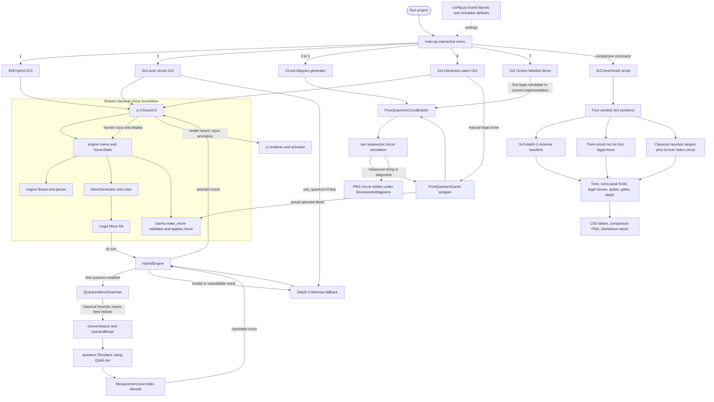

# Whole-project architecture

## What is shared and what is separate

- `engine/` owns the actual board and move rules in every playable route.
- `ui/` is shared by the 8×8, 3×3, and interactive 2×2 game modes.
- `ai/` supplies the hybrid 8×8 selector, minimax fallback, and 3×3 classical benchmark selector.
- `quantum/` builds and runs the move-index Grover circuit.
- `pure_quantum_engine/` constructs a different circuit: coordinates and statuses for one supplied move.
- The benchmark is a separate command-line experiment, not an additional GUI mode.

