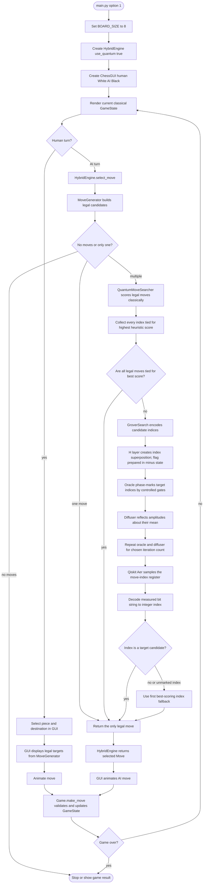

# 8×8 hybrid gameplay

## Connection details

1. `ui/gui.py` asks `Game`/`MoveGenerator` for legal targets and calls `HybridEngine.select_move` on the AI turn.
2. `HybridEngine` returns the sole legal move immediately when there is only one. Otherwise it calls `QuantumMoveSearcher` when quantum mode is enabled.
3. `ai/quantum_search.py` uses `HeuristicEvaluator.score_move` to choose target indices before Grover runs. Grover amplifies these already selected indices; it does not discover chess legality.
   If every legal move is tied for best, `GroverSearch` returns the first target directly and skips circuit construction.
4. `quantum/grover.py` creates a compact index register of `ceil(log2(candidate count))` qubits (minimum one) plus a phase-kickback flag. The index space is padded to a power of two when needed.
5. Measurement is decoded to a legal move-list index. If it does not map to a marked index, the implementation returns the first best index. If the quantum search path returns no move, `HybridEngine` uses depth-3 minimax.
6. `Game.make_move` remains authoritative: it validates and applies the selected move to the classical `GameState`.

**Important:** Grover does not search a coherent 8×8 board or game tree. Legal moves and heuristic targets are built by Python before the circuit is constructed.
