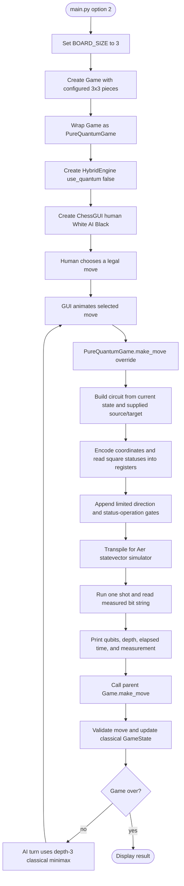

# 3×3 pure-circuit game

## What the 3×3 mode does

- Default example layout: White Knight `(2,1)` and Black Pawn `(0,0)`.
- The player's legal move is used as the circuit input; the circuit is not the move selector.
- The AI is deliberately configured as `HybridEngine(use_quantum=False)`, so its move comes from classical minimax.
- `PureQuantumCircuitBuilder` encodes the chosen move. The measured string is printed for diagnostics.
- The parent `Game.make_move` validates and applies the actual board transition classically.

**Scope note:** The circuit's direction/status operations are a prototype. They do not implement a complete reversible 3×3 chess state update.

