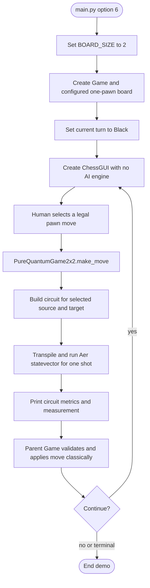
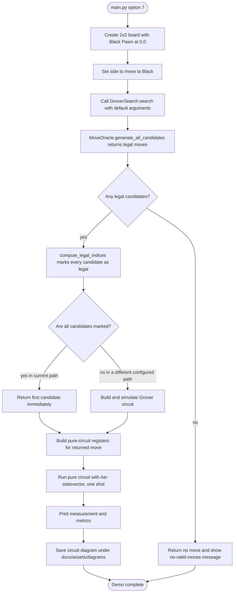

# 2×2 black-pawn demonstrations

The project has two separate 2×2 routes. Both use one Black Pawn at `(0,0)`, but they connect to the circuit in different ways.

## Menu option 6: interactive pawn demo

## Menu option 7: Grover-labelled autonomous demo

## Important current behavior

Menu option 7 is labelled as a Grover search demo, but the current call path does **not** execute a Grover circuit for its default candidates. `generate_all_candidates` returns only legal moves, and `compute_legal_indices` marks all of those as targets. `GroverSearch.search` returns the first candidate when every candidate is a target, before circuit construction. The following pure-circuit simulation does run. This behavior is shown explicitly so the diagram matches the code.

The destination `(1,0)` is the illustrative forward square for the black pawn. The pure circuit's measured result is diagnostic; the option 7 wrapper prints it and saves the circuit diagram but does not call `Game.make_move` to update the board.
