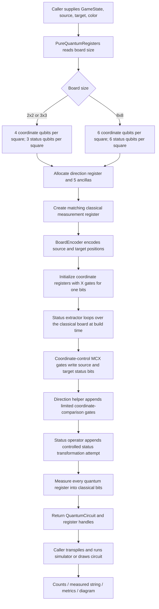

# Shared pure-circuit builder

This is the common path used when a game wrapper or circuit-diagram option asks `PureQuantumCircuitBuilder` to construct a circuit for one supplied source/target pair.

## Register totals

| Board | Coordinate bits per square | Status bits per square | Direction | Ancillas | Total |
|---|---:|---:|---:|---:|---:|
| 2×2 | 4 | 3 | 4 | 5 | 23 qubits |
| 3×3 | 4 | 3 | 4 | 5 | 23 qubits |
| 8×8 diagram allocation | 6 | 6 | 4 | 5 | 33 qubits |

There is no complete board register in this builder. The status extractor compiles a lookup from the **classical** board into gates. The circuit measures its working registers; game wrappers use the original `Move` object for the real board update. The movement comparator is limited and should not be presented as a general reversible chess legality checker.

