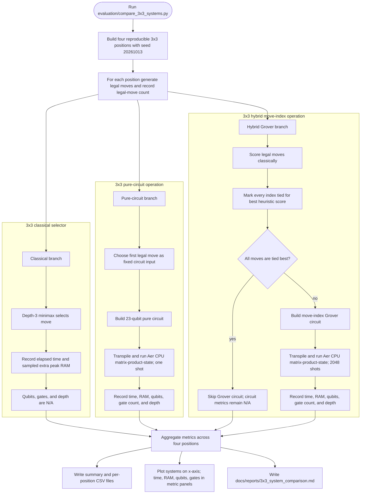

# 3×3 system-comparison benchmark

## How to interpret the branches

- **Classical:** measures depth-3 minimax move selection. There is no quantum circuit, so circuit metrics are N/A.
- **Pure circuit:** processes a fixed legal move; it does not autonomously select that move.
- **Hybrid:** legality and heuristic target selection happen classically, then Grover samples the compact index circuit. It is not a coherent search over all chess rules.
- All branches use the same four seeded positions. Simulator setup is excluded from the measured operation time; memory is an approximate sampled increase in process RSS.
- The result is a local simulator resource comparison. It does not measure move quality, hardware execution, or quantum advantage.

