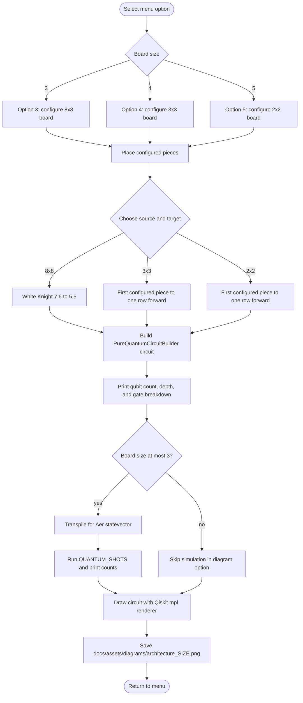

# Menu circuit-diagram generation

Menu options 3, 4, and 5 use `generate_circuit_diagram` in `main.py`. Option 7 also saves the 2×2 circuit image after running its autonomous demo.

## Example inputs and caveats

- **8×8 option 3:** places a White Knight at `(7,6)` and supplies target `(5,5)`. It constructs the 33-qubit circuit and prints its structure; this menu route does not run the simulation branch because the board size exceeds 3.
- **3×3 option 4:** uses the configured first piece (currently a White Knight at `(2,1)`) and chooses `(1,1)` as the “one row forward” circuit input. That is not a legal Knight move. The diagram generator constructs the circuit directly; it does not ask `MoveGenerator` to validate this source/target pair.
- **2×2 option 5:** uses the Black Pawn at `(0,0)` and target `(1,0)`, then runs the configured number of shots for the circuit display.
- These options inspect circuit structure. They are not gameplay transitions and do not update a `GameState`.
- Option 7 separately saves the same canonical 2×2 image after its 2×2 pure-circuit simulation.

