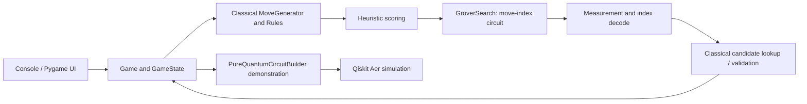

# Quantum Chess Engine: Architecture and Gate-Level Explanation

## Purpose and scope

This project is an educational chess engine with three related but distinct demonstrations:

1. **8×8 hybrid play**: classical chess rules generate legal moves and heuristics rank them. A Qiskit Grover circuit then samples among the best-scoring move indices. The classical `GameState` remains the authoritative board.
2. **3×3 pure-circuit demonstration**: a small pawn/knight board is encoded into registers and passed through a Qiskit circuit for status lookup, partial direction logic, a status-operation attempt, and measurement. The interactive game still applies the selected move through the classical game implementation.
3. **2×2 one-black-pawn demonstration**: a minimal board makes coordinate encoding and circuit wiring easier to inspect. It is useful for explaining gates, but it does not establish that the circuit is a complete, general chess rules engine.

The distinction matters: the project combines classical chess computation with quantum circuit simulation. It does not currently place an entire 8×8 board and its complete game tree into coherent quantum superposition, and it does not demonstrate a measured quantum advantage over a classical engine. The quantum contribution that is actually implemented is Grover-style amplitude amplification over indices in a classically prepared candidate list, plus a separate small-board reversible-circuit prototype.

## At-a-glance architecture

The `engine/` package represents the chess domain. `ai/` chooses moves. `quantum/` contains encoders, Grover components, measurement processing, and the Aer wrapper. `pure_quantum_engine/` constructs the paper-inspired board-coordinate/status circuit. `ui/` renders a game and collects user input. `main.py` selects a demonstration mode; `config.py` centralizes board defaults and simulation settings.

## The three board scales

### 2×2: smallest gate-level example

`config.INITIAL_PIECES_2x2` places one Black Pawn at `(row=0, col=0)`. In the demo, Black moves toward increasing row numbers, so the illustrative forward target is `(1,0)`. The UI and menu setup set Black to move because this layout contains only a black piece.

The coordinate encoder uses at least two bits per axis, even for a two-square axis. Its paper-style string is `column_bits + row_bits`:

| Square | Column + row | Encoded coordinate |
|---|---|---|
| `(0,0)` | `00 + 00` | `0000` |
| `(1,0)` | `00 + 01` | `0001` |
| `(0,1)` | `01 + 00` | `0100` |
| `(1,1)` | `01 + 01` | `0101` |

The compact status encoding used on boards smaller than 5×5 has three bits. Its first bit is color (`0` black, `1` white); the last two bits encode a compact piece category. Thus a Black Pawn is `001`, and empty is `000`. The status mapping reuses codes for some piece types, so this is not a unique encoding for all six standard chess types.

`PureQuantumRegisters` allocates 23 qubits for a 2×2 or 3×3 board: source coordinate 4, target coordinate 4, direction 4, source status 3, destination status 3, ancilla 5. The classical readout has 23 bits. These are the actual register allocations in the current source.

### 3×3: research-inspired prototype

`config.INITIAL_PIECES_3x3` currently contains a White Knight at `(2,1)` and a Black Pawn at `(0,0)` (the comments in that block say “pawn” for the first item, but the configured type is `KNIGHT`). Each coordinate still uses four qubits because two bits per axis represent values 0–3. A 3×3 board uses only nine of the sixteen representable coordinate pairs; the other basis states are outside the board.

The 3×3 route demonstrates the same pure-circuit builder and has a simple playable board. It is not an end-to-end quantum-only game: `PureQuantumGame.make_move` builds and simulates a circuit for the chosen move, prints its output/metrics, and then calls the classical `Game.make_move` to update the game state. In that mode the AI is explicitly constructed with `HybridEngine(use_quantum=False)`.

### 8×8: playable hybrid chess

`config.BOARD_SIZE` defaults to 8. Each coordinate axis requires `ceil(log2(8)) = 3` bits, so the pure-circuit register builder uses 6 bits for a square coordinate and 12 bits for source plus destination. For boards of size 5 or larger, the pure-circuit status width is six bits per square: one color bit and a sparse piece-type field. The full pure-circuit allocation at 8×8 is therefore 33 qubits (12 coordinate + 4 direction + 12 status + 5 ancilla). This is an allocation formula, not proof that the current circuit implements all 8×8 movement rules.

The normal 8×8 AI path is much smaller. It encodes an **index into the legal-move list**, not two board coordinates. For `N` legal moves, it allocates `ceil(log2(N))` move qubits (at least one) plus one flag qubit. For example, 30 candidates need 5 move-index qubits plus the flag. This avoids statevector storage exponential in the 33-qubit pure-circuit allocation, although the Grover oracle still has gate cost that grows with the number of marked indices and index width.

## 8×8 hybrid move-selection pipeline

The implementation in `ai/hybrid_engine.py` and `ai/quantum_search.py` follows these steps:

1. `MoveGenerator.generate_legal_moves(state)` computes the current side's legal moves classically. Piece-specific code handles pawn, knight, sliding-piece, and king movement and filters moves according to the project's king-safety logic. This is the source of the search candidates.
2. `HeuristicEvaluator.score_move` assigns a classical score to every legal move. It includes capture value (captured piece value multiplied by ten), pawn advancement, center preference, and piece-specific center preference. It does not run inside the quantum circuit.
3. The searcher finds the maximum score and collects **all indices tied for that maximum**. Those index values become oracle targets. Accordingly, in this call path Grover is amplifying heuristic-best moves, not discovering legality: legality was already resolved by `MoveGenerator`.
4. `GroverSearch` pads the index space to `2^n`, where `n=ceil(log2(number of legal moves))`. Hadamard gates put the index register into equal superposition over all `2^n` bitstrings. Indices in the padding range have no matching candidate and are not marked.
5. The flag is prepared as `|−⟩ = (|0⟩−|1⟩)/√2` by `X` followed by `H`. The phase oracle uses an MCX on the flag for each target index. Since `X|−⟩ = −|−⟩`, a matching index receives a minus sign by phase kickback.
6. The diffuser reflects amplitudes about their mean over the full `2^n` index space. Oracle and diffuser are repeated `max(1, floor((π/4)√(N/M)))` times as coded, where the call uses padded space size `N=2^n` and target count `M`.
7. The move register is measured. Qiskit count keys use classical bit ordering that the code accounts for with a bit reversal when converting to an integer. A valid measured target maps back to the original `Move` object. If the measured index is padding or non-target, the implementation returns the first heuristic-best index.
8. `HybridEngine` returns that candidate. If the quantum result is unavailable, it falls back to `MinimaxEngine(max_depth=3)`; in practice the searcher also has its own deterministic best-index fallback. A one-legal-move position bypasses the quantum call.

### Grover mathematics and what it means here

Let `N` be the padded number of index states, `M` the number marked, and `|s⟩` the uniform state. The phase oracle is

`O|x⟩ = −|x⟩` for marked `x`, and `O|x⟩ = |x⟩` otherwise.

The diffuser is `D = 2|s⟩⟨s| − I`. One Grover iteration is `G = DO`. In the ideal noiseless two-dimensional analysis, if `sin²(θ)=M/N`, then after `k` iterations the marked probability is `sin²((2k+1)θ)`. The commonly used approximate iteration count is near `(π/4)√(N/M)` when `M` is small relative to `N`.

This quadratic query result assumes an oracle that recognizes solutions at the appropriate cost. Here the legal list and heuristic targets are computed classically first, and the oracle is built by enumerating those integer indices into controlled gates. Therefore describe the quantum component as **amplitude amplification of classically selected best move indices**. Do not claim that the present code achieves a practical quadratic chess-engine speedup or evaluates all moves in superposition without classical pre-processing.

## Gate-by-gate explanation

### Computational basis and initialization

A qubit is represented as `α|0⟩+β|1⟩`, with measurement probabilities `|α|²` and `|β|²`. A register of `n` qubits spans `2^n` basis states. The statevector simulator stores amplitudes for those basis states, so classical simulation memory grows exponentially with qubit count.

In the pure circuit, `BoardEncoder.initialize_register` applies `X` to each bit position whose encoded classical string contains a `1`. Starting from `|000…0⟩`, this loads one computational-basis coordinate or status-derived value. This is classical basis-state initialization; it does not put every board position into superposition.

### X (NOT)

`X|0⟩=|1⟩`, `X|1⟩=|0⟩`. It is used to load 1-bits, temporarily convert a control-on-zero condition into control-on-one, prepare the Grover flag from `|0⟩` toward `|−⟩`, and implement the all-X portions of the diffuser. The condition-negation X gates must be undone so the compared data register is restored.

### H (Hadamard)

`H|0⟩=(|0⟩+|1⟩)/√2`, `H|1⟩=(|0⟩−|1⟩)/√2`. On each move-index qubit, H creates the uniform superposition `2^(−n/2) Σ_x |x⟩`. On the flag after X, it creates `|−⟩`, enabling phase kickback. In the diffuser, the H–X–MCZ–X–H pattern changes the phase marking into amplitude redistribution.

### CNOT (CX)

CX flips its target when its control is 1. It is a reversible two-qubit conditional operation. The pure-circuit direction and status routines use CX as part of their logic. In a properly designed reversible arithmetic network, temporary results are computed into workspace bits and later uncomputed; merely applying CX does not itself perform a general subtraction or comparison.

### Toffoli (CCX) and MCX

CCX flips a target if both controls are 1. MCX generalizes this to many controls. The pure-circuit status extractor temporarily flips coordinate bits where the sought coordinate contains 0, then controls MCX gates on the coordinate register to toggle status bits for a matching occupied square. The oracle similarly normalizes index bits for a target integer, applies MCX to the flag, then restores index bits. These gates implement reversible Boolean predicates when the surrounding controls and ancillas are designed correctly.

### Z / multi-controlled Z

Z changes the sign of `|1⟩` while leaving `|0⟩` unchanged. A multi-controlled Z marks the all-ones basis state with a minus phase. In the diffuser implementation it is synthesized as H on the last qubit, MCX, then H on that qubit (for more than one move qubit); this is the standard MCZ construction.

### Measurement

Measurement converts a quantum state into classical bits probabilistically according to squared amplitudes and collapses the measured state. The Grover path measures the move register to select an index. The pure circuit measures every allocated qubit into a classical register. Its measured string is diagnostic output; the interactive game does not decode that string to update all board squares. The classical move object drives the game transition.

## The pure circuit: registers and intended subcircuits

`PureQuantumRegisters` currently allocates:

| Register | Width | Intended role |
|---|---:|---|
| `cur` | 4 on 2×2/3×3; 6 on 8×8 | Source coordinate |
| `tgt` | 4 on 2×2/3×3; 6 on 8×8 | Destination coordinate |
| `dir` | 4 | Encoded movement category / direction workspace |
| `src` | 3 on small boards; 6 on 8×8 | Source-square status |
| `dst` | 3 on small boards; 6 on 8×8 | Destination-square status |
| `anc` | 5 | Scratch/workspace qubits |
| `meas` | same total width | Classical measurement memory |

`PureQuantumCircuitBuilder.build_full_chess_circuit` initializes source and target coordinates, appends source and target status extraction, appends direction logic, appends the status operator, and measures all quantum registers. The builder does not receive a global quantum register representing every board square. Instead, the board is read classically at circuit-construction time and encoded as controlled gate patterns.

### Status extraction

For every occupied board square, `_add_status_extractor` obtains the classical position and status encodings. It applies X gates to coordinate qubits where the desired coordinate bit is 0, so the desired coordinate becomes all ones; MCX gates then toggle output status bits whose encoded status bit is 1; it undoes the temporary X gates. Empty squares are skipped, which leaves the zero-initialized output unchanged for an empty target.

This is a circuit-generation-time lookup: Python iterates over the known board and writes a set of gates. It is not a quantum memory containing a superposition of all chess squares. Repeated XOR-style toggling also means correctness depends on mutually exclusive coordinate matching and the encoding/control order.

### Direction logic

The code labels `_add_direction_detection` as direction computation and includes comments describing pawn directions. It currently implements a limited pattern of CX, X, CCX, and MCX operations over selected coordinate bits. It is **not** a complete reversible subtractor/comparator for arbitrary coordinate differences, and the source contains an explicit comment that a full quantum subtractor and absolute-value circuit is still required for knight movement on 8×8. Do not present it as complete pawn/knight direction verification. A production version would need to define a precise bit convention, calculate signed/absolute deltas reversibly, set one-hot or binary direction flags, and uncompute all temporary carries and comparison results.

### Status operator and board update boundary

`_add_status_operator` applies X to destination status bits, combines direction, destination, and source status controls, uses MCX/CX operations on ancilla and destination bits, then restores the X gates. It is an attempt at conditional reversible status transformation. The current pure circuit has no quantum register for the complete board and does not write a new complete board state that is decoded back into `GameState`. It also does not fully encode all chess transition details such as source-square clearing, captures, castling, en passant, promotion, or self-check legality. In the game wrappers, after simulation, `super().make_move(move)` performs the real state update classically.

## Classical chess and AI modules

`engine/` contains board, position, piece, move, state, rule, move-generator, and evaluator logic. `MoveGenerator` has piece-specific movement generation, bounds/occupancy handling, and a king-safety filter. The codebase supports the six piece classes in the standard 8×8 board model, but some rules are intentionally simplified/variant behavior; inspect `engine/move_generator.py` and `engine/rules.py` before claiming tournament-standard chess. The minimax fallback searches to depth 3 when instantiated by `HybridEngine` (the class default is 6, but hybrid sets 3), uses alpha-beta pruning, move ordering, and a heuristic leaf score.

The heuristic is classical. `HeuristicEvaluator.evaluate` starts from `engine.Evaluator.evaluate` and adds a mobility term. `score_move` gives capture priority based on the captured piece's material value, encourages pawn advancement and center occupancy, and uses a simple center-distance score. These rules define which indices Grover marks in hybrid mode.

## Configuration and execution

`config.py` currently defines `BOARD_SIZE=8`, `TOTAL_SQUARES=64`, the 3×3 and 2×2 initial layouts, `QUANTUM_SHOTS=1024`, `QUANTUM_BACKEND="aer_simulator"`, `QUANTUM_NOISE_ENABLED=True`, and `QUANTUM_NOISE_PROB=0.01`. The Pygame defaults are 60 FPS and a 600×680 window. The pure-circuit demo wrappers sometimes override `config.BOARD_SIZE` at runtime; the register builder itself receives the board's actual size.

`QuantumSimulator` transpiles to a specified Aer-compatible basis-gate set, then attempts `AerSimulator(method="statevector", device="GPU")`; it falls back to a default Aer simulator if construction fails and has a runtime GPU-failure fallback to CPU. It runs the configured number of shots. If noise is enabled, it constructs depolarizing errors with probability `p` for single-qubit gates and `10p` for two-qubit gates, attaching these to selected basis operations. The effective error coverage depends on transpilation: the configured noise model does not automatically imply every abstract gate (for example, every decomposed CCX/MCX constituent) receives the intended error. This is a simplified simulator noise model, not a calibrated model of a specific quantum processor. Also, `main.py`'s pure-demo wrappers instantiate `AerSimulator` directly, so they do not use the `QuantumSimulator` noise configuration.

`requirements.txt` pins Qiskit 2.5.0 and Qiskit Aer 0.17.2 and lists NumPy, SciPy, Matplotlib, Pygame, Pytest, and developer tooling. The actual environment must satisfy those versions for reproducible output.

Typical entry point: `python main.py`. The menu has console/UI and demonstration modes; the code also contains functions for 8×8 hybrid play, 3×3 pure-circuit gameplay, 2×2 pure-circuit gameplay, and circuit generation. Prefer the menu text and source in `main.py` when describing exact option numbers because they may evolve.

## What to say in a faculty presentation

> “The 8×8 engine uses a classical chess model to construct and score legal moves. It then maps the best-scoring move-list indices into a compact register and uses Grover phase marking and diffusion to bias measurement toward those indices. Separately, the 2×2 and 3×3 demonstrations build a paper-inspired reversible circuit that encodes a source, target, and square statuses. The simulator output explains circuit behavior, while the classical game object still applies the move. This lets us study encoding, reversible controls, phase kickback, diffusion, measurement, and hybrid system boundaries without claiming that the current circuit is a complete quantum chess computer.”

## Limitations and next engineering steps

1. Specify and test the bit ordering and status encoding for all piece types; remove collisions in compact encodings or document their constrained domain.
2. Implement reversible coordinate subtraction, signed/absolute comparison, and complete direction flags; uncompute workspace cleanly.
3. Define a complete reversible board-state representation and transition, including source clearing, destination capture, promotion, special moves, and legality constraints—or explicitly keep this subsystem as a circuit visualization prototype.
4. Decide whether the oracle is for legal moves or for heuristic-optimal moves. If the goal is true quantum search, account for the cost of computing the marking predicate coherently, rather than preparing its answers classically.
5. Validate Grover probabilities over multiple seeds/shots and compare with the predicted `sin²((2k+1)θ)`; handle padding and iteration edge cases explicitly.
6. Calibrate a noise model to a named device/backend if hardware claims are needed. Separate simulator timing from quantum algorithmic complexity and from hardware execution time.
7. Use a standards-compliant chess rules library or add tests for check, stalemate, castling, en passant, promotion, and repetition before calling the 8×8 mode standard chess.

## Source map

| Topic | Main files |
|---|---|
| Settings and initial 2×2/3×3 positions | `config.py` |
| Program modes and demonstration wrappers | `main.py` |
| Board model and rules | `engine/board.py`, `engine/state.py`, `engine/rules.py`, `engine/move_generator.py` |
| Heuristic and minimax | `ai/heuristic.py`, `ai/minimax.py` |
| Hybrid pipeline | `ai/hybrid_engine.py`, `ai/quantum_search.py` |
| Grover circuit | `quantum/grover.py`, `quantum/oracle.py`, `quantum/diffuser.py`, `quantum/measurement.py` |
| Board encoding and simulation | `quantum/encoder.py`, `quantum/decoder.py`, `quantum/simulator.py` |
| Pure-circuit registers and gates | `pure_quantum_engine/registers.py`, `pure_quantum_engine/circuit.py`, `pure_quantum_engine/engine.py` |

## Repository organization after cleanup

The repository keeps implementation files in their existing package directories. Faculty reports are grouped in `docs/reports/`; diagrams are in `docs/assets/diagrams/`; ASCII circuit dumps are in `docs/circuits/`; evaluation code and its plot remain in `evaluation/`; and the circuit inspection utilities are in `tools/`. The 2×2 diagram had byte-identical copies, so one canonical diagram is retained at `docs/assets/diagrams/architecture_2x2.png`. Python bytecode and Pytest caches were removed as disposable output. The ignored `venv1/` environment and hidden workspace metadata were preserved. The path-producing scripts and references were updated to use the organized locations; chess rules and quantum algorithms were left unchanged. See [`folder_dir.md`](folder_dir.md) for the responsibility of every project file and folder.
